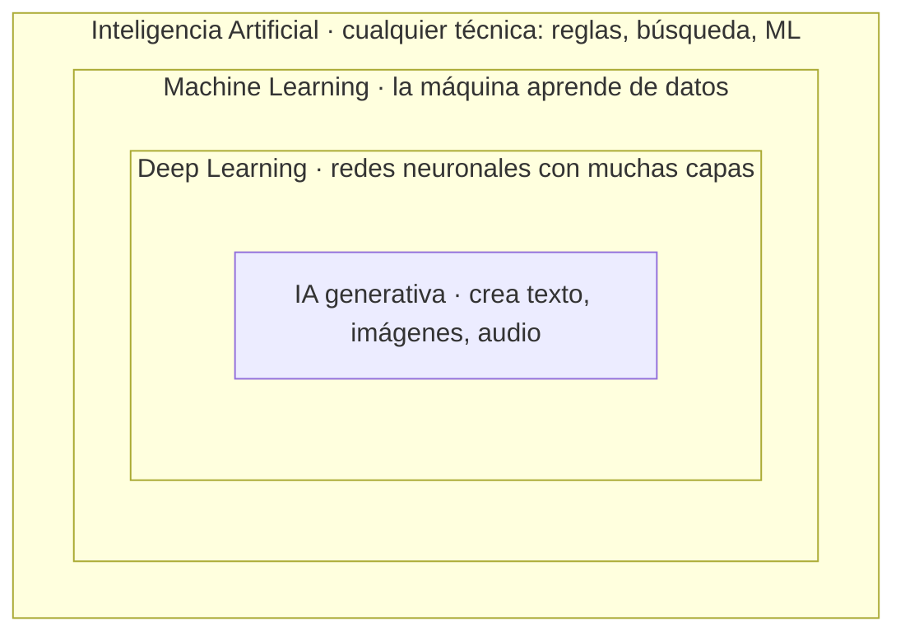
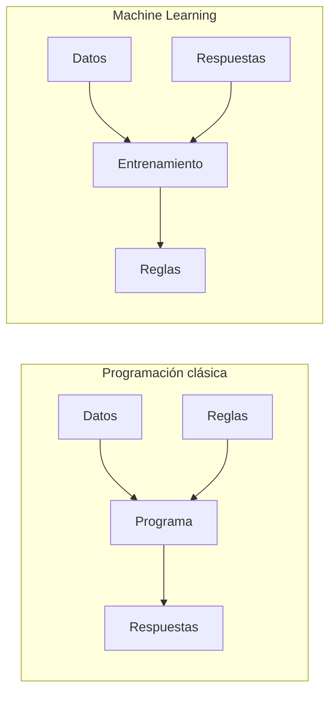

# Módulo 0. El mapa del terreno

**Fase 1: Fundamentos** · [⬅ Temario](../../README.md) · [Siguiente: Módulo 1 ➡](../01-caja-de-herramientas/README.md)

## Objetivos

- [ ] Distinguir IA, Machine Learning, Deep Learning e IA generativa
- [ ] Entender el cambio de "escribir reglas" a "aprender de datos"
- [ ] Conocer los hitos principales de la historia de la IA
- [ ] Diferenciar aprendizaje supervisado, no supervisado y por refuerzo
- [ ] Saber qué puede hacer la IA hoy y cuáles son sus límites

---

## 1. ¿Qué es la IA?

La **inteligencia artificial** es el campo que busca que las máquinas hagan tareas que, si las hiciera una persona, diríamos que requieren inteligencia: reconocer una cara, entender una frase, jugar ajedrez, traducir o conducir.

Los términos que oirás todo el tiempo están **anidados**, como muñecas rusas:

- **IA:** el paraguas general. El pathfinding de un videojuego ya es IA, aunque no aprenda nada.
- **Machine Learning (ML):** en lugar de programar las reglas, le das **ejemplos** y el sistema deduce las reglas por sí mismo.
- **Deep Learning:** ML que usa redes neuronales con muchas capas. Es lo que funciona con imágenes, voz y texto.
- **IA generativa:** deep learning que **produce** contenido nuevo. Ahí entran los chatbots y los generadores de imágenes.

## 2. La idea clave para alguien que programa

Este es el cambio mental más importante del curso:

En [`codigo/filtro_spam.py`](codigo/filtro_spam.py) tienes los dos enfoques lado a lado:

- Un filtro de spam **clásico**, donde tú escribes la lista de palabras sospechosas.
- Un filtro que **aprende**: nadie le dice qué palabras son sospechosas; las descubre contando en qué correos aparece cada una.

La palabra "premio" no aparece escrita en ninguna regla del segundo filtro. El comportamiento sale de los **datos**: si cambias los ejemplos, cambia el programa sin tocar una sola línea. Esto es Machine Learning en miniatura. Todo lo que veremos después, incluidos los grandes modelos de lenguaje, es una versión muchísimo más sofisticada de la misma idea.

## 3. Breve historia

| Año | Hito |
|-----|------|
| 1950 | Alan Turing pregunta "¿Pueden pensar las máquinas?" y propone su famosa prueba |
| 1956 | Conferencia de Dartmouth: nace el término "inteligencia artificial" |
| 1958 | El perceptrón de Rosenblatt, la primera neurona artificial |
| 1970s–80s | Los "inviernos de la IA": las promesas no se cumplen y se recorta la financiación |
| 1980s | Sistemas expertos: miles de reglas escritas a mano. Funcionan, pero no escalan |
| 1997 | Deep Blue vence a Kasparov al ajedrez (búsqueda y fuerza bruta, sin aprendizaje) |
| 2012 | AlexNet arrasa en reconocimiento de imágenes: arranca la era del deep learning |
| 2016 | AlphaGo vence al campeón mundial de Go |
| 2017 | El paper "Attention Is All You Need" presenta el **Transformer** |
| 2022 | ChatGPT lleva los modelos de lenguaje al público general |

La lección de fondo es que la IA pasó de **escribir reglas** a **aprender de datos**. Ese cambio solo fue posible cuando hubo suficientes datos (internet) y suficiente potencia de cálculo (las GPUs).

## 4. Los tres tipos de aprendizaje

| Tipo | Analogía | ¿Hay respuestas? | Ejemplo |
|------|----------|------------------|---------|
| **Supervisado** | Estudiar con tarjetas que traen la respuesta al dorso | Sí, cada ejemplo tiene su etiqueta | Detectar spam, predecir precios |
| **No supervisado** | Ordenar un cajón de calcetines sin instrucciones | No, el modelo busca estructura | Agrupar clientes parecidos |
| **Por refuerzo** | Entrenar a un perro o aprender un videojuego | Solo premios o castigos tras actuar | AlphaGo, robots |

El aprendizaje supervisado es el más usado en la industria. Nuestro filtro de spam es supervisado.

## 5. Qué puede hacer la IA hoy y qué no

**Lo hace muy bien:** reconocer patrones (caras, voz, fraudes), traducir, resumir, generar texto, imágenes y código, y recomendar contenido.

**Sus límites reales:**

- **Alucina:** puede inventar datos con total seguridad, porque genera lo *probable*, no lo *verdadero*.
- **Depende de sus datos:** si los datos están sesgados, el modelo también lo estará.
- **Falla fuera de lo que conoce:** un modelo entrenado con fotos de día puede fallar de noche.
- **No garantiza nada:** a diferencia de tu código, no hay certeza de que responda igual ni de que acierte. Por eso evaluar modelos (Módulo 5) es tan importante.

---

## Ideas clave

> 1. La IA es el paraguas; ML, Deep Learning e IA generativa son subconjuntos anidados.
> 2. Programar es escribir reglas. Hacer ML es dar ejemplos para que el sistema deduzca las reglas.
> 3. Supervisado = con respuestas; no supervisado = sin respuestas; refuerzo = premios y castigos.
> 4. La IA genera lo probable, no lo verdadero.

👉 Siguiente paso: [ejercicios.md](ejercicios.md)
